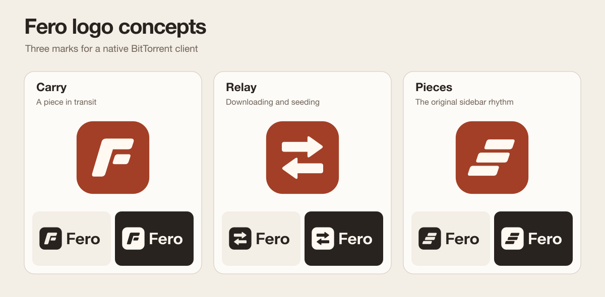

# Fero logo system



**Carry was the recommendation in the first exploration.** The detached stroke in the forward-leaning F suggests a piece in transit and ties the mark to Fero’s Latin name, “to carry, bring, bear.” Its letterform gives the app an identifiable silhouette at launcher and sidebar sizes.

**Relay** uses two opposed arrows to represent downloading and seeding. **Pieces** uses three staggered bars to evoke BitTorrent pieces and carry forward the desktop mockup’s existing mark. All three use rounded tiles and a wordmark outlined from the bundled Instrument Sans Semibold.

The design follows the [project plan](../../../PLAN.md), [README](../../../readme.md), and [desktop mockup](../../fero-desktop.html).

The current direction is Pieces. See the [second round of Pieces refinements](pieces-v2/README.md).

## Layouts

| Layout | Use | Suggested digital minimum |
| --- | --- | --- |
| [Horizontal](carry/fero-carry-horizontal-ember.svg) | Site headers, documentation, and release materials | 104 px wide |
| [Vertical](carry/fero-carry-vertical-ember.svg) | Narrow spaces and stacked placements | 72 px wide |
| [Square](carry/fero-carry-square-ember.svg) | Profile images that have room for the name | 88 px wide |
| [Icon](carry/fero-carry-icon-ember.svg) | Launcher, sidebar, and favicon | 16 px for the favicon, 24 px for standard use |
| [Wordmark](fero-wordmark-ember.svg) | Text-only placements | 60 px wide |

Keep clear space around the visible artwork equal to a quarter of the tile width. For the wordmark alone, use half the height of the capital F. Keep proportions fixed and use solid backgrounds with clear contrast. For print, start at 25 mm wide for lockups and proof the mark at the final size.

## Color

| Variant | Colors | Background |
| --- | --- | --- |
| Ember | Ember tile `#A33F27`, parchment mark `#FFF9F2`, graphite wordmark `#29231F` | Light surfaces such as `#FDFBF7` |
| Graphite | Graphite `#29231F` with transparent cutouts | Light surfaces and single-color print |
| Parchment | Parchment `#FFF9F2` with transparent cutouts | Dark surfaces such as `#201D1A` |

## Files and export

The [Carry](carry), [Relay](relay), and [Pieces](pieces) folders each contain four layouts in three color variants. The three shared wordmark files sit alongside those folders. The Ember and graphite wordmark-only versions share the same graphite fill for light backgrounds.

The SVGs have transparent canvases and outlined lettering. For the web, use an image tag such as ``. Use an empty alt attribute when adjacent text already names Fero. For print, place the SVG in the layout and proof the document with the printer’s color profile.

To export a 512 px transparent PNG with librsvg, run this command from this directory.

```sh
rsvg-convert --width 512 carry/fero-carry-icon-ember.svg --output fero-icon-512.png
```
