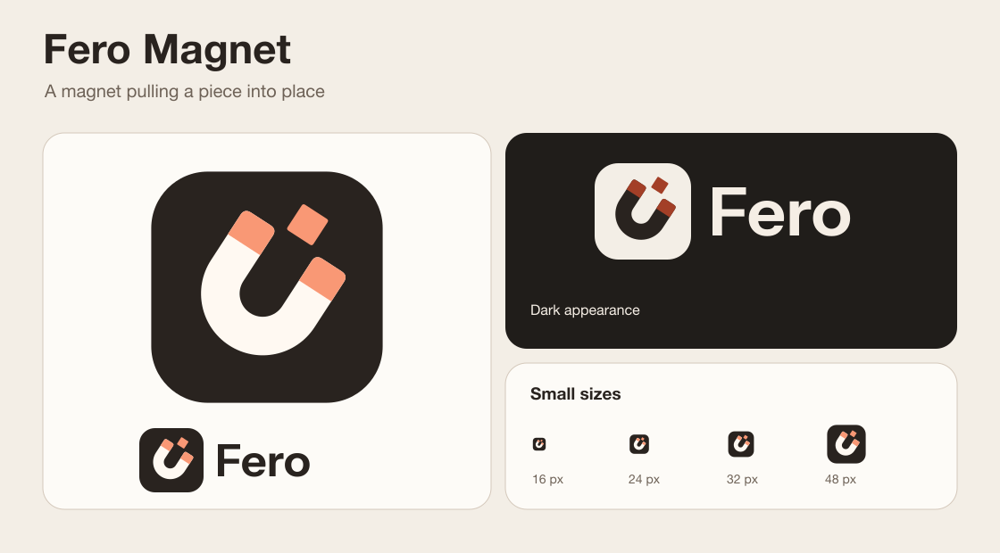

# Fero Magnet



A tilted horseshoe magnet pulls in a square piece. The two colored poles identify the magnet at a glance, and the floating square connects it to BitTorrent’s piece-by-piece transfers. The wordmark uses outlined Instrument Sans Semibold.

| Version | Use |
| --- | --- |
| [Graphite icon](fero-magnet-icon-graphite.svg) · [Horizontal logo](fero-magnet-horizontal-graphite.svg) | Light surfaces. Graphite tile `#29231F`, parchment body `#FFF9F2`, Ember poles and piece `#F99875`. |
| [Parchment icon](fero-magnet-icon-parchment.svg) · [Horizontal logo](fero-magnet-horizontal-parchment.svg) | Dark surfaces. Parchment tile `#F3EEE6`, graphite body `#29231F`, Ember poles and piece `#A33F27`. |
| [Monochrome icon](fero-magnet-icon-mono.svg) · [Horizontal logo](fero-magnet-horizontal-mono.svg) | Single-color uses on light surfaces. The magnet and piece are transparent cutouts. |

Each version includes icon, horizontal, vertical, and square layouts. Use the icon for compact placements and the horizontal lockup where there is room for the name. The icon was checked at 16, 24, 32, and 48 px. Use 24 px or larger when space allows so the floating piece is easier to see.

For a transparent PNG export, run this command from this directory.

```sh
rsvg-convert --width 512 fero-magnet-icon-graphite.svg --output fero-magnet-512.png
```
