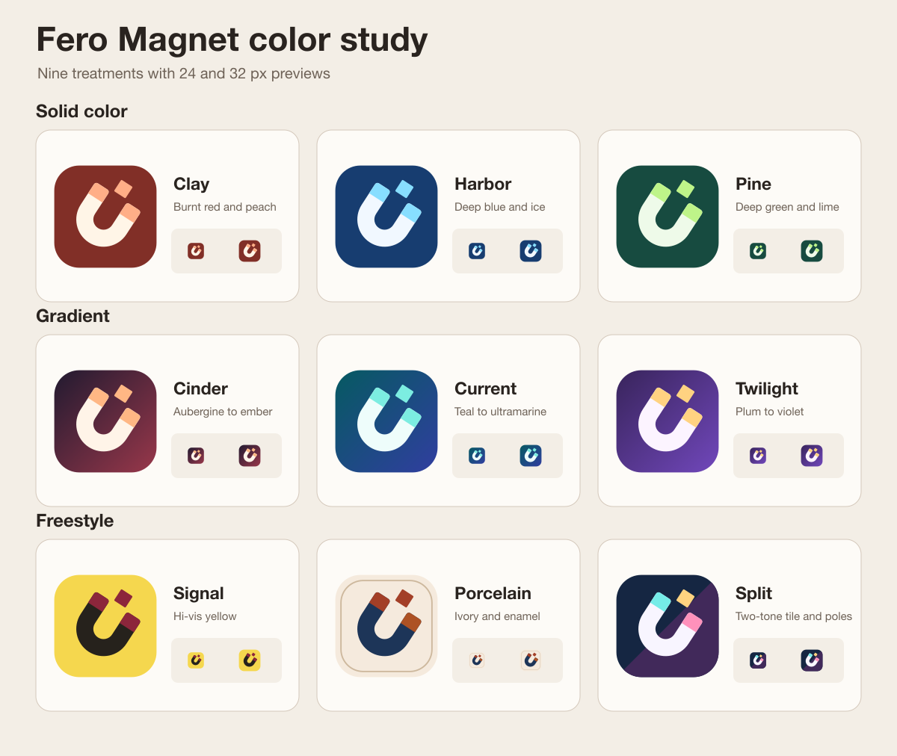

# Fero Magnet color study

Each treatment uses the approved horseshoe magnet and floating piece. The SVG files have transparent outer margins and can be scaled for app icon exports.

| Treatment | SVG | Palette |
| --- | --- | --- |
| Solid | [Clay](fero-magnet-clay.svg) | Burnt red, cream, and peach |
| Solid | [Harbor](fero-magnet-harbor.svg) | Deep blue, icy white, and sky blue |
| Solid | [Pine](fero-magnet-pine.svg) | Deep green, pale mint, and lime |
| Gradient | [Cinder](fero-magnet-cinder.svg) | Aubergine to ember with warm peach poles |
| Gradient | [Current](fero-magnet-current.svg) | Teal to ultramarine with aqua poles |
| Gradient | [Twilight](fero-magnet-twilight.svg) | Plum to violet with gold poles |
| Freestyle | [Signal](fero-magnet-signal.svg) | High-visibility yellow, graphite, and burgundy |
| Freestyle | [Porcelain](fero-magnet-porcelain.svg) | Ivory with a fine inset border, navy body, and rust poles |
| Freestyle | [Split](fero-magnet-split.svg) | Two-tone tile, cyan and pink poles, and a gold piece |

The comparison sheet includes 24 and 32 px samples. All nine SVGs also render at 16 px.

## Harbor Current

Harbor’s deep blue and ice-white magnet combine with Current’s teal-to-ultramarine gradient. Split contributes the diagonal tile, two-tone poles, and gold piece. The pink pole is softened to sit alongside the cooler blues and teal.

[Preview](harbor-current-preview.png) · [Icon SVG](fero-magnet-harbor-current.svg) · [Light wordmark SVG](fero-magnet-harbor-current-horizontal-light.svg) · [Dark wordmark SVG](fero-magnet-harbor-current-horizontal-dark.svg)
