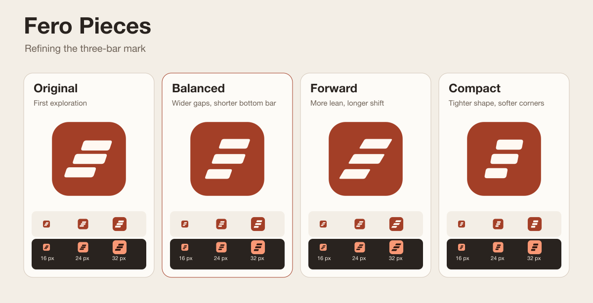

# Fero Pieces refinements

All three refinements keep the staggered bars, rounded tile, and Ember palette from the earlier Pieces concept. The bars echo the desktop mockup’s sidebar mark and suggest pieces moving through a transfer.

| Refinement | Design |
| --- | --- |
| [Balanced](fero-pieces-balanced-icon-ember.svg) | Wider, even gaps give each bar more definition at 16 and 24 px. The shorter bottom bar gives the shape a clear taper. |
| [Forward](fero-pieces-forward-icon-ember.svg) | A steeper cut and a wider stagger emphasize movement. |
| [Compact](fero-pieces-compact-icon-ember.svg) | A narrower silhouette and softer corners give the mark a quieter look. |

Balanced is the recommended refinement. It has horizontal, vertical, square, and icon layouts. Each layout comes in light Ember, dark Ember, graphite, and parchment. Forward and Compact have icon SVGs in both Ember appearances for comparison. The Instrument Sans wordmark uses outlined glyphs.

- [Balanced horizontal, light Ember](fero-pieces-balanced-horizontal-ember.svg)
- [Balanced horizontal, dark Ember](fero-pieces-balanced-horizontal-ember-dark.svg)
- [Balanced icon, light Ember](fero-pieces-balanced-icon-ember.svg)
- [Balanced icon, dark Ember](fero-pieces-balanced-icon-ember-dark.svg)

The dark Ember variant uses the app’s peach `#F99875` tile, dark brown `#301811` bars, and parchment `#F5EEE5` wordmark. For spacing and export settings, see the [logo system guide](../README.md).
