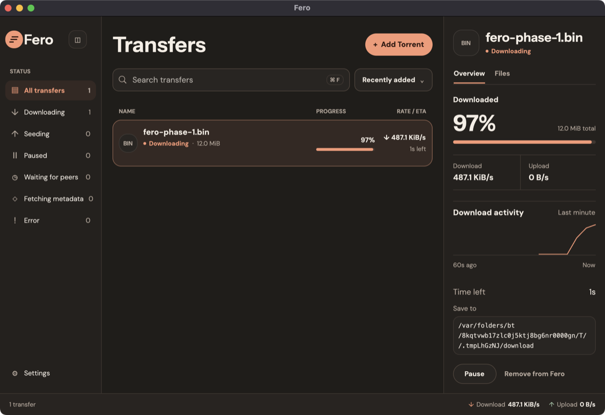
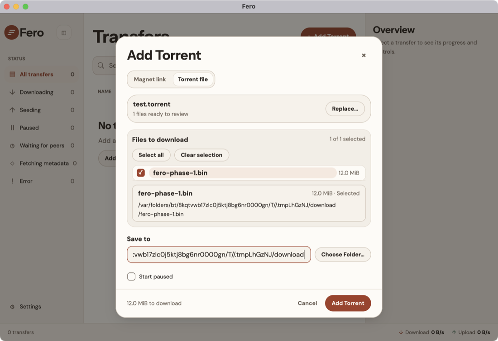

# Fero

**A native BitTorrent client for everyday downloads and large libraries.** Review a torrent’s files before adding it, see what’s happening at a glance, and keep seeding after closing the window.

[Features](#features) · [Screenshots](#screenshots) · [Getting started](#getting-started) · [Release status](#release-status)

*Transfer library on macOS · Dark appearance*

## Features

- **Choose what to download.** Paste a magnet link or drop a `.torrent` file. Preview filenames, sizes, and save paths, then download only the files you select. You can also add a magnet right away or keep a new transfer paused.
- **Manage a busy library.** Search by name, category, or tag; filter by status; reorder the queue; and pause, resume, or remove transfers in bulk. Set library-wide and per-torrent speed limits and seeding goals.
- **See why a transfer stalled.** Inspect connected peers, tracker status, file priorities, and recent transfer rates. Reannounce to trackers or recheck local files from the desktop.
- **Resume and keep seeding.** Transfers, file selections, and pause states survive restart. Close the window and reopen Fero from the menu bar or tray while transfers keep running.
- **Control how Fero connects.** Choose Direct, SOCKS5, or VPN-interface routing. Fero pauses affected traffic if the selected proxy or VPN becomes unavailable.
- **Automate repeat downloads.** Import from watched folders or RSS and Atom feeds with include/exclude rules, and set a daily bandwidth schedule.
- **Control transfers from your phone.** Enable authenticated HTTPS access on your local network to add, view, pause, and resume torrents from a browser.
- **Import a qBittorrent library.** Preview an existing profile, review destinations and duplicates, and import selected transfers paused for a file check.

## Screenshots

**Add Torrent on macOS · Light appearance** — Review the file list, check the full save path, and choose a destination before adding.

The [interactive desktop mockup](design/fero-desktop.html) shows more layouts with simulated transfers.

## Getting started

Follow the [build-from-source instructions](docs/development.md#build-fero-locally) for your platform. Fero uses Rust, [GPUI](https://gpui.rs/), and libtorrent 2.1.2.

1. Open Fero and choose **Add Torrent**.
2. Paste a magnet link or select a `.torrent` file. For a magnet, choose **Get File List** to review the contents before adding.
3. Pick the files and save folder, then confirm. Select the transfer in the library to see its progress and controls.

See [Using Fero](docs/using-fero.md) for appearance, automation, background operation, and LAN setup.

## Release status

Fero is in development. Desktop workflows have been tested on Intel macOS and Fedora Linux. Apple Silicon and Windows installed-app testing are still pending, and clean-install qualification is incomplete. See the [release qualification matrix](docs/development.md#qualification-progress), [packaging instructions](docs/development.md#build-a-test-release), and [current roadmap](PLAN.md#settings-and-production-readiness).

## Contributing and license

See [CONTRIBUTING.md](CONTRIBUTING.md) for local checks and pull requests, and [SECURITY.md](SECURITY.md) to report a vulnerability privately.

Fero’s original work is licensed under the [MIT License](LICENSE). Third-party material retains its own terms, including the [Solar icon attribution](design/icons/ATTRIBUTION.md), the [DM Sans](design/fonts/DM-Sans-OFL.txt) and [Instrument Sans](design/fonts/Instrument-Sans-OFL.txt) font licenses, the [GPUI example license](src/GPUI-LICENSE-APACHE) for the adapted text field, and the [libtorrent notices](docs/licenses/libtorrent-2.1.2.txt) for upstream code in the native patches. See [dependency notices](docs/licenses/) for other bundled components.

*Fero* (FEH-roh) is Latin for “to carry, bring, bear.”
